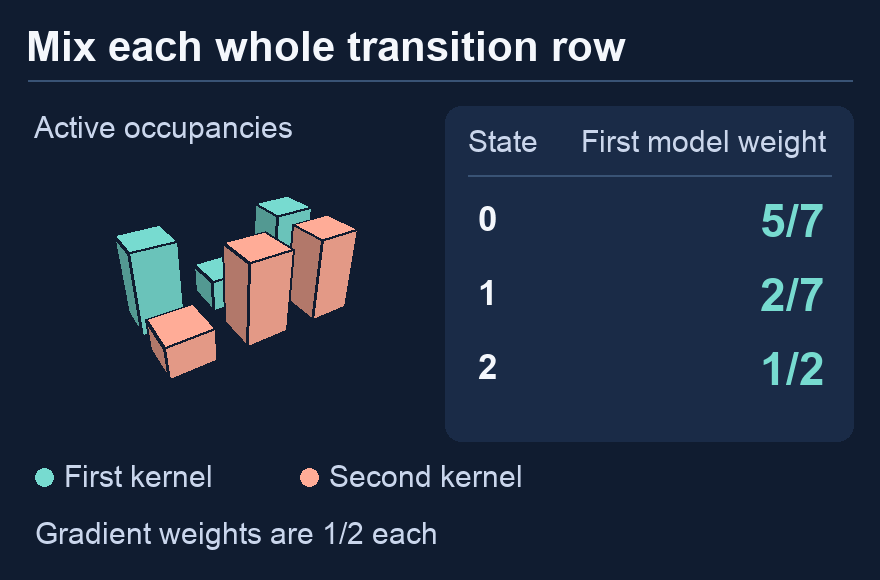

# Subgradient dominance under state-rectangular transition uncertainty

   

A finite discounted robust Markov decision process with fixed costs, compact state-rectangular transition uncertainty and a full-support initial law satisfies subgradient dominance for every direct-policy Fréchet subgradient. This includes the minimum over subgradients in the original conjecture.

[Read the paper](paper/manuscript.pdf) · [LaTeX source](paper/manuscript.tex) · [Original conjecture](https://arxiv.org/pdf/2604.21177v2#page=10) · [Version DOI](https://doi.org/10.5281/zenodo.24572581)

## Explore the proof in 3D

Choose a gradient mixture and a state. At equal gradient weights the first kernel gets whole-row weights 5/7, 2/7 and 1/2 in states 0, 1 and 2. Each is the first kernel’s share of the combined discounted visits at that state. Both actions use the same state-specific coefficient.

[Download the offline explorer](https://raw.githubusercontent.com/DannyExperiments/state-rectangular-subgradient-dominance/v1.0.0/visualization/occupancy-rows-explorer.zip) · [Explorer source](visualization/index.html) · [Worked example](proof/worked-occupancies.md) · [GIF rendering source](visualization/render.py)

## Why the proof works

The statewise Bellman equation makes all active kernels agree on the value vector. A convex combination of their gradients can then be represented by a single kernel in the statewise convexification, with transition rows weighted by discounted occupancy. The new kernel has the same value and the required occupancy. An ordinary performance difference gives the bound for that gradient, so it also holds for the minimum over all subgradients.

The source’s two sufficient conditions cover restricted classes. Earlier efficient robust evaluation and dominance results for the adversary’s kernel optimization address different claims. [Primary-source comparison](audits/public_safe_reports/LITERATURE.md)

## Reproduce the checks

    python3 -I scripts/verify_repository.py
    python3 -I verification/src/replay.py

[Recorded replay](verification/results/replay.txt) · [Scope](CLAIM_SCOPE_AND_LIMITATIONS.md) · [Reproducibility](REPRODUCIBILITY.md) · [Research disclosure](AI_DISCLOSURE.md)

## Cite

DannyExperiments. *Subgradient dominance under state-rectangular transition uncertainty*. Version 1.0.0, 27 November 2026. [Version DOI](https://doi.org/10.5281/zenodo.24572581).
